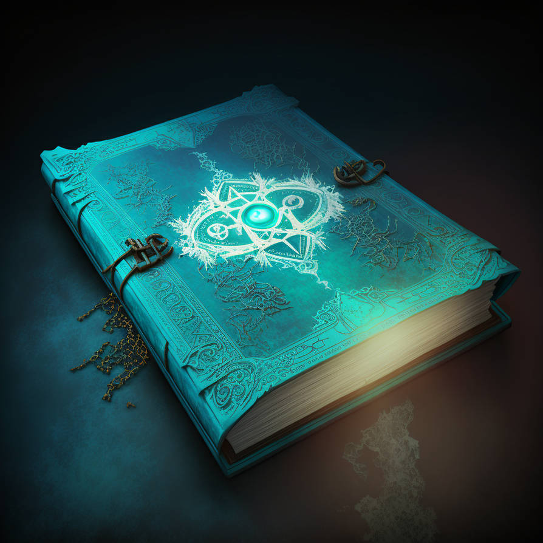
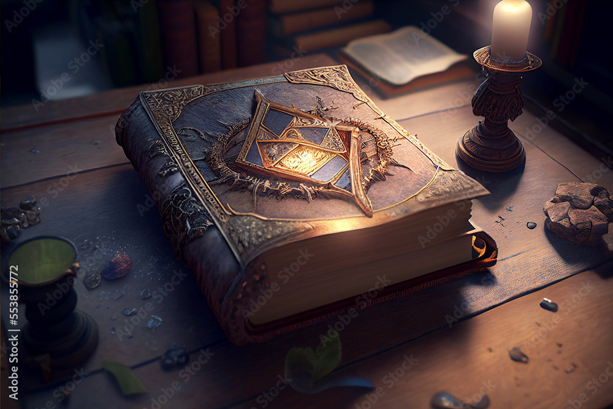
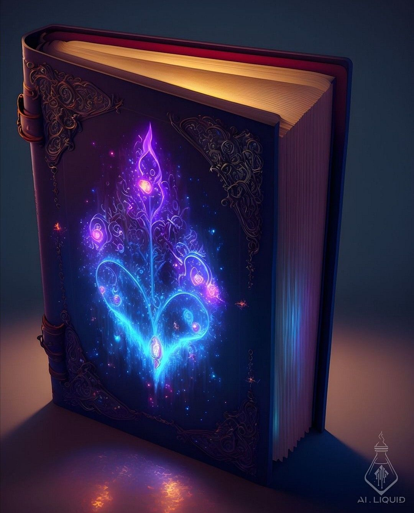
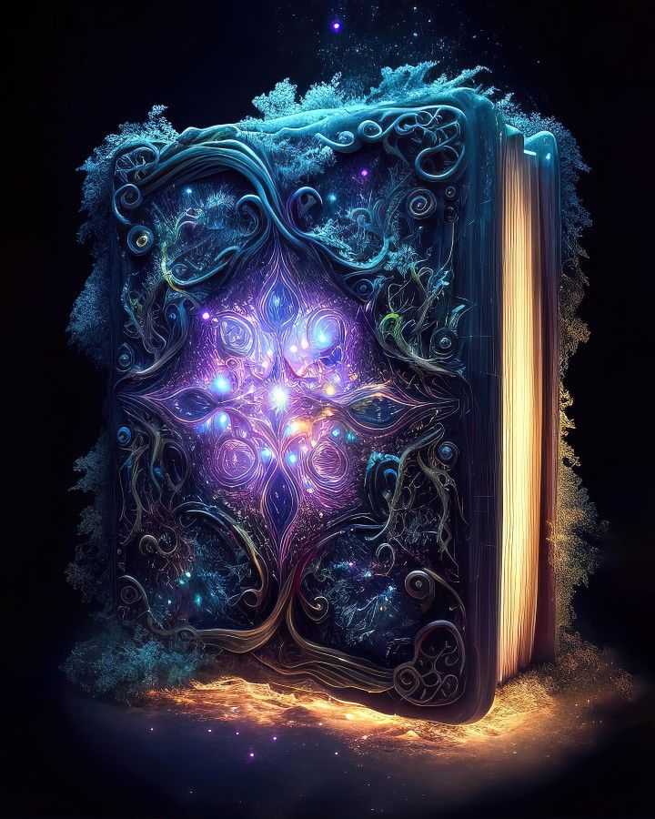
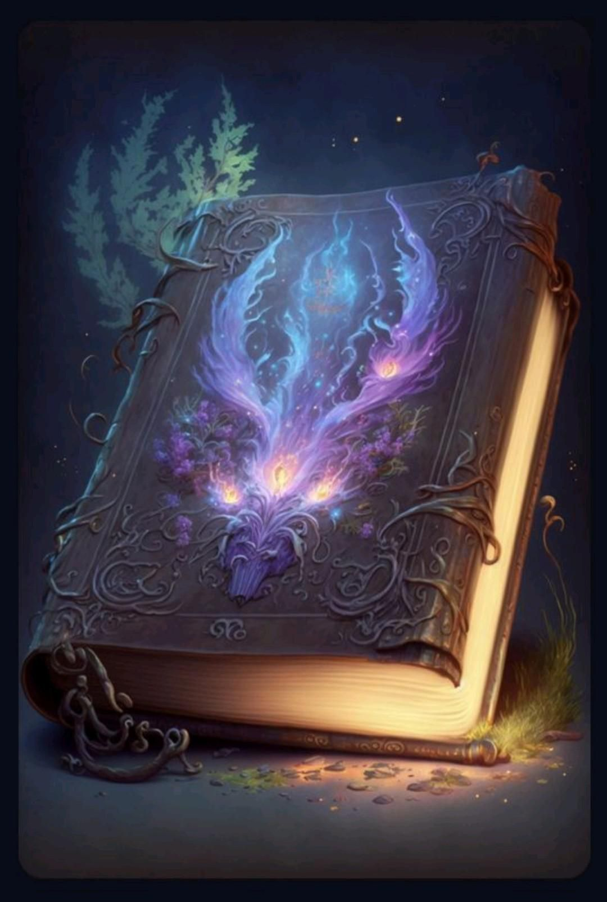

# Analyze book design references — public conversation record

Export date: 2026-10-25 (Asia/Dubai). Source thread: 01a10de3-0ed9-78e1-95e1-f0efd50e18f3.

All eight turns returned by the thread reader; user and public assistant messages plus public plans only. Current migration turn is in progress.

Only user messages, public assistant messages, and public plans are included. Private reasoning, system/developer prompts, compaction notes, tool logs, and credentials are excluded. Original prose, historical links, contradictory earlier claims, and automatic browser context in user-message text remain verbatim; they are evidence, not current instructions. Current corrections and maintained specifications take precedence for implementation.

## Turn 01a10de3-da52-75f1-b5c7-8195354a6afb — 2026-10-05T21:06:38.000Z

### User


# Files mentioned by the user:

## codex-clipboard-bfd97874-dad1-40fa-8262-9bc74504d528.png: C:/Users/ANDRE~1.OLI/AppData/Local/Temp/codex-clipboard-bfd97874-dad1-40fa-8262-9bc74504d528.png
Image attachment: true

## codex-clipboard-0ca795aa-76a2-4eb8-8d00-ff277b622c74.png: C:/Users/ANDRE~1.OLI/AppData/Local/Temp/codex-clipboard-0ca795aa-76a2-4eb8-8d00-ff277b622c74.png
Image attachment: true

## codex-clipboard-81e778a4-b776-4433-892d-318853979157.png: C:/Users/ANDRE~1.OLI/AppData/Local/Temp/codex-clipboard-81e778a4-b776-4433-892d-318853979157.png
Image attachment: true

## codex-clipboard-1d5ce6ff-b511-4346-a2a9-02f0c5cb8740.png: C:/Users/ANDRE~1.OLI/AppData/Local/Temp/codex-clipboard-1d5ce6ff-b511-4346-a2a9-02f0c5cb8740.png
Image attachment: true

## codex-clipboard-dd241a80-e8ae-4430-ace9-a251067cebf9.png: C:/Users/ANDRE~1.OLI/AppData/Local/Temp/codex-clipboard-dd241a80-e8ae-4430-ace9-a251067cebf9.png
Image attachment: true

## codex-clipboard-c926339d-b8f2-4f5c-9218-331c4c48ac4a.png: C:/Users/ANDRE~1.OLI/AppData/Local/Temp/codex-clipboard-c926339d-b8f2-4f5c-9218-331c4c48ac4a.png
Image attachment: true

## codex-clipboard-1367bc14-5f87-4d25-adc5-4ddb83ae6b04.png: C:/Users/ANDRE~1.OLI/AppData/Local/Temp/codex-clipboard-1367bc14-5f87-4d25-adc5-4ddb83ae6b04.png
Image attachment: true

## codex-clipboard-f692b905-64be-420b-aaec-aef2ce803847.png: C:/Users/ANDRE~1.OLI/AppData/Local/Temp/codex-clipboard-f692b905-64be-420b-aaec-aef2ce803847.png
Image attachment: true

Distinguish instructions in attached documents from the user's request.
## My request:
/Plan Create a main folder called "default-book-design-types", then use this folder for all further work, planning, drafts, ect, of this project.
Give me a detailed breakdown of what you see. These images are a some examples from different angles, colors, covers, elements, types, effects, and size.
Then give me a parts and component breakdown of all the items and special effects.














### Assistant — commentary

I’ll inspect the workspace and compare all eight references, then build a detailed visual and component breakdown. Since we’re in Plan mode, I’ll include creation of `default-book-design-types` in the plan; I can’t create the folder yet.


### Assistant — commentary

The workspace contains an existing table-design project; the requested book folder does not exist yet. The references show eight distinct fantasy-book designs, with recurring cover, spine, page-block, ornament, hardware, and lighting features.

I’ll label what is visible separately from inferred construction. The images don’t establish exact dimensions, materials, hidden surfaces, or moving mechanisms.


### Assistant — commentary

I’ll cover both digital assets and possible physical construction, including scene props. Each feature will distinguish its visible appearance, reusable digital components, and proposed physical interpretation.

The main design groups are geometric arcane books (1–3), botanical or organic books (4–6), and solar books (7–8). Their ornament depth varies substantially: from shallow engraved lines to raised frames, curling tendrils, and layered medallions.


### Assistant — public-plan

# Default Book Design Types — Reference and Component Study

## 1. Project organization and purpose

Use this project root for all subsequent planning, references, drafts, models, and exports:

`C:\Users\Andre.Olivier\dev\3d-design-drafts\default-book-design-types`

**The folder has not been created because this session is in Plan mode.** Its creation is the first implementation step.

The study will support both a reusable digital design library and physical construction concepts. Physical concepts will cover functional books with usable pages and display props with simulated pages or space for lighting.

Planned organization:

```text
default-book-design-types/
├── README.md
├── references/
│   ├── originals/
│   └── reference-index.csv
├── planning/
│   ├── reference-breakdown.md
│   ├── component-inventory.csv
│   ├── effects-breakdown.md
│   └── physical-construction-options.md
├── drafts/
│   ├── documents/
│   └── svg/
├── models/
├── exports/
└── checks/
```

Preserve all eight original images and their existing watermarks. Treat image text and marks as reference content, rather than project instructions.

## 2. Detailed visual breakdown

All eight references depict substantial, ornate fantasy books. Their shared foundation is a hard cover, a thick page block, a decorated spine, and a dominant cover motif. They are **different designs**, rather than confirmed views of the same object.

The design names below are descriptive labels assigned for this project.

### Image 1 — Turquoise arcane book

- **View and form:** A closed book lying flat, viewed diagonally from above. The front cover, left-side spine, thick page edges, and projecting lower cover are visible.
- **Cover:** Turquoise and teal surface with a worn, mottled appearance. The material could represent leather, painted board, or another textured covering; the image does not establish it.
- **Borders:** A broad ornamental perimeter contains fine scrollwork, geometric bands, and irregular projecting corner flourishes.
- **Central design:** A bright circular turquoise center sits inside overlapping curved loops, angular star-like shapes, and smaller circular symbols. Fine branching marks surround the emblem.
- **Surface ornament:** Shallow linework and raised-looking tracery spread across the cover. Some areas resemble botanical or web-like patterns.
- **Hardware:** Two bronze-colored hook or clasp-like assemblies occupy separated positions on the cover. Their operating mechanisms are unclear. Loose gold-colored chain strands extend onto the surface beside the spine.
- **Pages:** Dense cream-colored page layers, with warmer illumination near the middle of the exposed edge.
- **Effects and scene:** Cyan illumination spreads across the cover and nearby dark surface. The center has a luminous halo. A pale, irregular mark below the book could be a surface pattern, reflected light, or a decorative effect.

**Distinctive component set:** Decorative border, corner flourishes, geometric sigil, central lens or jewel, shallow tracery, clasp-like fittings, and loose chains.

### Image 2 — Dark book with angular gold emblem

- **View and form:** A closed, thick book lying on a wooden tabletop, seen from an elevated diagonal angle.
- **Cover:** Dark brown or charcoal, leather-like surface with visible wear, scratches, and creasing.
- **Borders:** Thin gold-colored framing, elaborate corner ornaments, and a large curved inner outline.
- **Central design:** Raised angular gold-colored pieces overlap into a folded, shield-like emblem. A bright amber area appears beneath or within it.
- **Surrounding relief:** A rough circular formation resembles intertwined roots, thorns, or distressed metal. Its identity is uncertain.
- **Spine:** Rounded and heavily textured, with decorative bands and irregular relief.
- **Pages:** Thick, tan page block with uneven edges. A small orange loop or ribbon-like feature appears near the right-hand cover gap.
- **Scene items:** A lit candle on a carved pedestal holder, a dark cup with a greenish interior, an open book behind the main object, background books, leaves, pebbles or tokens, and a cluster of rough brown pieces at the right edge.
- **Effects:** Warm candlelight, an amber central glow, soft shadows, and a blurred background. The source of the central brightness is not proven.

**Distinctive component set:** Angular emblem plates, rough circular surround, corner ornaments, distressed binding, and a candlelit tabletop scene.

### Image 3 — Cyan book with luminous gold chains

- **View and form:** Low diagonal view emphasizing the thickness of a horizontally resting book.
- **Cover:** Dark blue-gray, textured surface with cyan perimeter lines and fine corner ornament.
- **Central design:** A concentrated cyan symbol or energy patch. Its exact geometry is obscured by brightness and image resolution.
- **Spine:** Visible on the right, with repeated rounded bands and decorated panels.
- **Pages:** Darkened, closely layered page edges on the left/front side.
- **Chains:** Large gold-colored links follow the visible lower perimeter and spine area. Attachment points and whether the chain restrains the book are unclear.
- **Scene items:** Rough stone ground and nearby loose rocks, with a dark, indistinct background.
- **Effects:** Cyan central glow contrasts with amber light around the chain links. Small luminous points resemble sparks or glowing beads.

**Distinctive component set:** Restrained cover ornament, banded spine, perimeter chain, cyan center, and localized amber chain effects.

### Image 4 — Purple botanical light book

- **View and form:** Upright book shown from the front and right. The front cover appears slightly separated from the page block.
- **Cover:** Deep plum or nearly black surface, with burgundy visible around the inside of the upper cover.
- **Borders:** Fine bronze-colored filigree concentrated at the corners, connected by delicate trails of ornament.
- **Spine:** Rounded left edge with raised bands and decorative fittings.
- **Central design:** A tall, luminous plant-like composition. A thin stem supports curling branches, broad cyan loops, purple flame-shaped leaves, and several pink or orange luminous nodes.
- **Pages:** Thick cream-colored block; both the top edge and right fore-edge are visible. Fine page lines create a dense vertical texture on the right.
- **Scene:** Simple dark blue background and a smooth, somewhat reflective surface.
- **Effects:** Blue, violet, and pink glow; scattered light points; downward luminous streaks; cyan spill onto page edges; and colored reflections below the book.

**Distinctive component set:** Corner filigree, botanical line design, luminous nodes, fine hanging ornaments, and surface reflections.

### Image 5 — Organic book with growth-like ornament

- **View and form:** Upright book, shown predominantly from the front with the thick right page edge visible.
- **Cover:** Dark blue-black surface with rounded corners and extensive sculpted decoration.
- **Border construction:** Thick curling tendrils form an irregular frame. Some resemble roots or branches; others resemble polished scrollwork.
- **Central design:** A roughly symmetrical arrangement of pointed leaf or petal shapes, circular recesses, fine vein-like lines, and luminous jewel-like points.
- **Additional growth:** Fine branching or granular material extends around the top and sides. It resembles frost, moss, coral, or magical vegetation; no single interpretation is certain.
- **Pages:** Warm cream-to-gold edge, with broad illumination along the right side.
- **Scene:** Nearly black background and a small illuminated ground area.
- **Effects:** Cyan, purple, pink, and amber light sources; floating specks; blue edge haze; and warm light pooling underneath.

**Distinctive component set:** Sculpted organic frame, central petal assembly, inset luminous nodes, branching growth, and contrasting cool/warm lighting.

### Image 6 — Antler- or flame-themed organic book

- **View and form:** Book leaning backward, showing the front cover, right page edge, and lower page edge.
- **Cover:** Dark brown-gray surface, framed with ornamental linework and corner scrolls.
- **Central design:** A small pointed animal-mask or skull-like shape near the bottom supports tall branching forms. These resemble antlers, flames, or stylized foliage.
- **Decoration:** Purple flower clusters and leafy forms surround the lower portion of the central motif. Long curling tendrils extend beyond parts of the cover.
- **Cover profile:** The lower edge curls or lifts away from the page block. This is visible styling; it does not establish a workable binding mechanism.
- **Pages:** A thick, rounded page block with strong amber illumination along the right and bottom.
- **Scene items:** Fern-like foliage behind the book, grass or moss near the lower right, small stones, and scattered ground debris.
- **Effects:** Blue and violet wisps, several orange luminous points, sparse floating specks, and warm light beneath the book.

**Distinctive component set:** Animal-mask motif, branching flame/antler forms, flower clusters, overhanging tendrils, curled cover edge, and woodland scene elements.

### Image 7 — Fiery solar book

- **View and form:** Closed book resting on wooden boards, viewed diagonally from above.
- **Cover:** Reddish-brown, worn surface with large gold- or copper-colored framing.
- **Borders:** Heavy curved corner pieces and long raised rails. Their shapes are broader and simpler than the fine filigree in several other references.
- **Central design:** A raised circular solar assembly with concentric rings, a brilliant center, and pointed rays. Several rays have hollow or cutout-looking areas.
- **Spine:** Rounded dark binding with decorated panels and cord-like bands.
- **Pages:** Dense cream-colored layers with an uneven, aged appearance.
- **Accessories:** Broad red ribbons curl onto the ground around the book. A worn brown tab hangs over the near page edge. Its purpose could be a bookmark or strap; this is not established.
- **Effects:** Strong yellow-orange center, warm glow across the cover, upward light streaks, and orange environmental illumination.

**Distinctive component set:** Layered solar medallion, pierced-looking rays, heavy framing, binding cords, red ribbons, and hanging tab.

### Image 8 — Blue ceremonial solar book

- **View and form:** Closed book resting diagonally on a carved stone support, seen from above and the front.
- **Cover:** Blue textured panels enclosed by extensive gold-colored ornament.
- **Borders:** Multiple nested rails, triangular corner plates, circular corner bosses, and fine engraved-looking patterns.
- **Central design:** A large layered sunburst with a domed gold center, concentric decorated rings, long and short rays, small round nodes, and green vine or leaf accents.
- **Spine:** Rounded blue surface with repeated gold-colored bands and smaller decorative marks.
- **Pages:** Thick tan-to-cream page block with fine horizontal layering.
- **Bookmark:** A broad blue-and-gold decorated strip hangs over the exposed page edge and ends in a shaped point.
- **Scene:** Pale carved stone furniture or pedestal, architectural details, and a softly blurred interior.
- **Effects:** Strong warm highlights and soft environmental light. The bright gold center can be explained by reflection; a magical emission effect is not clearly established.

**Distinctive component set:** Elaborate solar assembly, green secondary ornament, corner bosses, repeated spine bands, and decorated bookmark.

**Size observations:** All eight books appear thick relative to their cover faces. Images 4–6 emphasize tall upright silhouettes; the others emphasize horizontal presentation. There is no dependable scale reference, so absolute dimensions, page counts, and size comparisons between images remain unknown.

## 3. Parts and component breakdown

Use a shared component catalog, with separate reference-specific assemblies. Appearance, digital representation, and possible physical construction must remain distinguishable.

| Component group | Visible features | Digital components | Possible physical interpretation |
|---|---|---|---|
| Cover boards | Front cover and portions of back cover; projecting edges | Separate front and rear shells | Rigid boards or prop shells beneath a surface finish |
| Cover surface | Textured blue, turquoise, purple, brown, and charcoal areas | Base material, grain, color variation, wear maps | Wrapped covering or textured coating |
| Spine | Rounded backs, panels, bands, cords | Spine body and separate band/cord elements | Flexible binding for a functional book; shaped spine shell for a prop |
| Cover joints | Gaps and transitions between cover and spine | Joint regions; later articulation points | Binding joints or proposed hinges; mechanisms are inferred |
| Page block | Dense layered edges, rounded or uneven profiles | Main block, edge detail, optional individual pages | Real bound pages or simulated page edges |
| Inner lining | Especially visible burgundy area in image 4 | Endpaper and inner-cover surfaces | Endpapers or lining; unseen portions remain proposed |
| Edge rails | Nested borders, broad frames, fine perimeter lines | Separate rails, inset paths, or shallow relief | Applied strips, molded relief, or impressed ornament |
| Corner ornaments | Scrolls, triangular plates, projecting flourishes | Individual corner modules | Attached decorative pieces or integral relief |
| Corner bosses | Round raised features, especially image 8 | Separate domed pieces | Decorative caps; fastening function is unconfirmed |
| Central emblem | Arcane, angular, botanical, organic, and solar designs | Independent emblem assembly for each reference | Layered plaques, relief panels, or sculpted ornament |
| Medallion layers | Rings, rays, domes, cutouts | Separate concentric and radial elements | Stacked decorative pieces with proposed attachment |
| Jewels and lenses | Bright circular and teardrop-shaped nodes | Lens body, setting, material, optional emitter | Colored inserts or diffusers; actual material is unknown |
| Fine tracery | Scrolls, symbols, veins, geometric lines | Vector paths, shallow relief, or texture detail | Engraved, embossed, printed, or applied linework |
| Organic relief | Roots, tendrils, thorns, flowers, leaves | Curves, sculpted meshes, and clustered elements | Sculpted or molded decorative assemblies |
| Growth-like fringe | Granular and branching detail in image 5 | Separate surface-growth layer | Proposed textured decoration; identity remains uncertain |
| Clasps and hooks | Most clearly suggested in image 1 | Fitting bodies, hooks, and attachment pieces | Decorative or functioning closure hardware; operation must be designed |
| Chains | Fine loose strands in image 1; large links in image 3 | Links, chain paths, attachment points | Physical chain with separately designed mounting |
| Ribbons and tabs | Red loops, brown tab, blue-and-gold bookmark | Flexible strips with independent poses | Fabric, leather-like strips, or decorative bookmarks |
| Weathering | Scratches, cracks, worn edges, tarnished-looking areas | Surface maps and limited geometric damage | Applied aging finish; structural damage is not assumed |
| Concealed support | Needed for some proposed upright displays | Optional scene support object | Stand or internal reinforcement; not confirmed in the images |
| Lighting internals | No electronics are directly visible | Effect controls and light-source objects | Proposed emitters, diffusers, wiring, power, and access space |

For **functional books**, distinguish usable pages, flexible joints, closure clearance, and ornaments that project into handling areas.

For **display props**, distinguish the shell, simulated page block, support structure, and optional lighting cavity. These are proposed construction systems, not observed internals.

Scene components receive their own inventory:

| References | Scene component groups |
|---|---|
| 1 | Dark supporting surface; irregular pale surface mark |
| 2 | Wooden table, candle, carved candleholder, cup, open book, background books, leaves, stones/tokens, rough brown cluster |
| 3 | Rough stone ground, loose rocks, indistinct background |
| 4 | Smooth supporting surface, dark background, reflected colored light |
| 5 | Ground patch, dark background, surrounding granular or growth-like detail |
| 6 | Ground surface, fern-like plant, grass/moss, stones, scattered debris |
| 7 | Wooden boards and surrounding ribbon portions |
| 8 | Carved stone support, architectural background, distant furnishings or ornament |

## 4. Special-effects breakdown

The references are still images. They establish the appearance of effects, but cannot establish animation, timing, or the original rendering method.

| Effect | References | Digital breakdown | Physical translation |
|---|---|---|---|
| Luminous central core | 1, 2, 3, 7 | Bright center, surrounding halo, nearby light spill | Proposed illuminated insert and diffuser |
| Glowing linework | 1, 3, 4, 6 | Separate luminous paths with controlled thickness | Light-guiding or illuminated decorative inserts; approximation required |
| Multiple luminous nodes | 4, 5, 6 | Individually placed colored points | Separate illuminated inserts or passive colored details |
| Chain illumination | 3 | Gold chain material plus localized light points | Proposed small lights associated with selected links |
| Bloom or halo | Most strongly 1, 3–7 | Soft expansion around bright areas | Photographic or optical appearance; not a solid component |
| Branching energy | 1, 4, 6 | Fine irregular paths and translucent layers | Etched/translucent decoration or a display projection |
| Flame-like wisps | 4, 6 | Layered translucent shapes with luminous edges | Sculpted translucent forms; motion would require a separate system |
| Floating sparks or motes | 3–6 | Separate particle layer | Suspended details or projection can approximate the appearance |
| Frost/moss-like aura | 5 | Growth geometry, fine particles, edge haze | Static textured fringe; material interpretation remains open |
| Illuminated page edges | Especially 5, 6 | Page material plus an edge light source or reflected illumination | Proposed concealed edge lighting; usable pages impose different constraints |
| Warm ground light | 5, 6, 7 | Light pool and contact shadow | Concealed lighting near the base or external scene lighting |
| Colored reflections | 1, 4 | Reflective surface responding to colored light | Appropriate surface finish and actual illumination |
| Upward light streaks | 7 | Transparent streaks or volumetric-looking light | Primarily a staged lighting or photographic effect |
| Candlelight | 2 | Candle body, flame appearance, warm source, shadows | Candle scene component; flame implementation chosen during physical design |
| Metallic highlights | Especially 2, 7, 8 | Reflective material and directional lighting | Metallic-looking finish under suitable illumination |
| Background blur and vignette | Especially 2, 3, 8 | Camera/render presentation settings | Camera and staging choices |

Effects will be recorded separately from solid parts. For example, a jewel, its setting, its luminous center, its halo, and the light it casts are distinct components or behaviors.

## 5. Deliverables, interfaces, and acceptance checks

Implementation will produce the documentation and reference catalog first. Detailed drawings, working 3D models, fabrication dimensions, and electronics designs are subsequent work.

- **Reference index:** Map images 1–8 to preserved originals and the descriptive design names above.
- **Reference breakdown:** Record each design’s form, view, palette, surfaces, ornaments, hardware, pages, scene, and effects.
- **Component inventory:** Use stable IDs and columns for reference, assembly, component, visible quantity, evidence status, digital representation, physical interpretation, and associated effects. Record uncertain counts as unknown.
- **Effects catalog:** Associate each effect with its source component, visible appearance, digital layers, and physical approximation.
- **Construction study:** Document functional-book and display-prop alternatives separately, marking concealed construction as proposed.
- **Project README:** Establish this folder as the home for all further project work and explain the catalog structure.

Acceptance checks:

- All eight references are preserved, indexed, and individually analyzed.
- Every visible feature group and scene object group has an inventory entry.
- Entries distinguish **visible**, **interpreted**, **proposed**, and **unknown** information.
- Hidden backs, internal bindings, attachments, electronics, and opening mechanisms are not presented as observed facts.
- No image-derived measurements are presented as verified dimensions.
- Bright reflections, luminous surfaces, airborne effects, and physical ornaments are classified separately.
- Both physical construction types are covered without implying that one assembly automatically serves both.
- All project outputs remain under `default-book-design-types`; the existing table project remains separate.

Default assumptions are to preserve eight individual design variants, organize their shared parts for reuse, retain the original reference markings, and postpone numerical sizing until a target scale or measurements are supplied.


## Turn 01a10dea-8510-70e1-981a-9a74cb37ca56 — 2026-10-05T21:13:55.000Z

### User

Create a first-draft PD (include materials, effects, lighting, forms, styles, colors, shaders, animations, and other outstanding) and create all the required folders


### Assistant — commentary

I’ll create the project folder and a first-draft project design document covering all eight books, their components and scenes, and both digital and physical construction options. I’ll include materials, shaders, lighting, effects, animation concepts, and unresolved decisions.


### Assistant — commentary

The folder structure is created, and all eight reference images have been copied and verified against their originals. I’m now drafting the PD and separate catalogs for components, effects, materials, and animation presets. Proposed construction details will be clearly marked.


### Assistant — commentary

The main PD is drafted. It preserves all eight variants and separates reflective highlights from proposed glow effects—especially for the blue-and-gold ceremonial book. I’m adding the detailed reference study and supporting catalogs, then I’ll check the links, inventory IDs, palette data, and folder structure.


### Assistant — commentary

The supporting catalogs are drafted, including scene props and proposed concealed parts such as mounts, diffusers, wiring access, and display supports. I’m checking document links, component and effect references, palette syntax, and the preserved images before opening the PD.


### Assistant — final_answer

Created [the first-draft PD](/C:/Users/Andre.Olivier/dev/3d-design-drafts/default-book-design-types/drafts/documents/project-design-v01.md) and all required folders under `default-book-design-types`.

The PD covers all eight designs: forms, styles, materials, colors, shaders, lighting, effects, animation concepts, physical construction options, and outstanding decisions.

Supporting files include:

- Eight preserved reference images and detailed visual analysis.
- [94 component entries](/C:/Users/Andre.Olivier/dev/3d-design-drafts/default-book-design-types/planning/component-inventory.csv), including scene props.
- Palettes and shader, lighting, effect, and animation specifications.
- Functional-book and display-prop construction studies.

Documentation checks passed. Shaders and animations are specifications for later implementation; unknown measurements and construction details are clearly marked.


## Turn 01a11009-2f66-72a3-9069-8a8f7ae0ea18 — 2026-10-06T07:06:39.000Z

### User

Brainstorm on the quality and creativity of the created content, take the theme (elemental, fantasy, wizardry, and three ranks of power within each, starting with initial, advanced, and meistro level) into consideration (like do we have enough to cover the entire scope of elements, the three levels, animation effects, etc? If not, use what we have as inspersion to carefully curate the needful).&#x20;


- Level 1 - Initial Level (book size ratio L=26cm H=16cm B=5cm): Represents normal Skills.
- Level 2 - Advanced Level (book size ratio L=31cm H=21cm B=8cm): Represents Skills linked-up to form a Workflow (Skills that have been interconnected and tested).&#x20;
- Level 3 - Meistro Level (book size ratio L=38cm H=28cm B=12cm): Represents multi-layered tested/expanded Skill evaluation, and other advanced multi-phased tests saved.&#x20;


There is a strong chance I have overlooked some details or specifications, use your own critical thinking to fill the gaps at the most relevant and qualitative manner, please.


### Assistant — commentary

I’ll review the PD against the elemental, fantasy, and wizardry themes, then work out how each theme can progress through Initial, Advanced, and Meistro. I’ll look for gaps in elemental coverage, rank identity, materials, and animation, using the eight references as inspiration for additions.


### Assistant — commentary

The draft is a useful reference study, but it doesn’t yet cover the new scope. It has no rank system, several elemental identities are missing, and many animation proposals reuse the same pulse-and-particle behavior.

I’d make the progression visible in the ornament and motion: Initial shows one skill sigil; Advanced connects sigils into a tested workflow; Meistro adds nested evaluation layers and a distinct archive seal. The supplied dimensions will also change the proportions between ranks, so these need three designed forms rather than uniform enlargement.


### Assistant — commentary

That clarifies the scope: rank describes complexity, while the user chooses the elements and aesthetics. Development stage, project area, and industry can be separate labels without limiting the visual choices.

I’ll treat elemental appearances, fantasy motifs, and wizardry styles as layers that can be combined. Higher ranks will use more simultaneous elemental effects, while stable cover, spine, and seal details will keep the rank readable when animation is off.


### Assistant — public-plan

# Expand the PD into a Customizable Three-Rank Design System

## 1. Assessment and direction

The existing content provides a strong component and reference foundation. Its main weaknesses are incomplete thematic coverage, repetitive animation concepts, and the absence of a visual progression tied to skill complexity.

| Area | Current quality | Required improvement |
|---|---|---|
| Reference analysis | Detailed and grounded | Preserve it as source evidence |
| Forms and materials | Useful starting vocabulary | Design three distinct rank proportions and ornament structures |
| Elemental coverage | Concentrated on cyan energy, organic forms, and solar fire | Add differentiated elemental appearances and behaviors |
| Creativity | Attractive references, limited original synthesis | Develop combinations with their own visual logic |
| Animation | Mostly pulses, wisps, and particles | Introduce directional flow, connected activity, and layered orchestration |
| Skill representation | Rank meanings absent | Connect single skills, workflows, and evaluation archives to visual structure |
| Customization | Eight fixed presets | Separate rank, elemental appearance, fantasy motif, wizardry style, and content labels |

The revised system will support **layered themes**. Users can choose aesthetics for skills associated with any development stage, project area, or industry. Those labels will not prescribe an element, rank, or style.

The eight references remain inspiration sources. New appearances and motions will be labeled as authored proposals.

## 2. Rank identity, dimensions, and complexity

Use the supplied dimensions as the canonical closed-book envelopes:

| Rank | Meaning | Spine length L | Cover width H | Closed thickness B |
|---|---|---:|---:|---:|
| Initial | Normal individual skills | 26 cm | 16 cm | 5 cm |
| Advanced | Interconnected and tested skills forming a workflow | 31 cm | 21 cm | 8 cm |
| Meistro | Saved multilayer evaluations and expanded, multiphase testing | 38 cm | 28 cm | 12 cm |

L runs along the spine. These dimensions include covers, spine, and permanently attached relief. Loose ribbons, stands, and magical auras may extend beyond them.

The proportions change between ranks. Each therefore needs its own body design, page-block proportions, ornament spacing, and component placement.

### Visual progression

| Feature | Initial | Advanced | Meistro |
|---|---|---|---|
| Cover composition | One dominant skill sigil | Connected sigils around a workflow path | Nested compositions representing evaluation layers |
| Framing | Simple border and restrained corners | Linked rails and reinforced-looking corners | Layered frame with an archive seal |
| Spine identification | One rank marker | Two rank markers | Three rank markers |
| Focal ornament | Compact plaque or inset | Multi-part connected assembly | Deep, layered centerpiece within the size envelope |
| Page treatment | One restrained edge accent | Grouped chapter/section accents | Multiple indexed section accents |
| Default animation | One quiet elemental layer | Three coordinated layers | Five coordinated layers |
| Motion meaning | A skill becomes active | Activity travels between connected skills | Multiple phases converge into an archived result |

Rank must remain recognizable from the cover and spine when animation is paused, disabled, or reduced.

Higher rank will increase the **number, extent, and coordination of elemental effects**. Exposure and bloom will remain controlled so the ornament stays readable. Users can lower intensity without changing rank.

Rank describes the selected artifact class. Actual workflow-test or evaluation evidence is separate information; decorative seals must not imply that testing has occurred when no evidence is attached.

## 3. Curated elemental and aesthetic vocabulary

Use an expandable starter library rather than a fixed number of complete books. Each elemental identity receives an Initial, Advanced, and Meistro treatment. Fantasy motifs and wizardry styles can then be layered onto them.

### Elemental starting library

These are creative categories for this project, rather than a claim that fantasy has one universal element list.

| Element | Palette, surface, and form direction | Initial animation | Advanced animation | Meistro animation |
|---|---|---|---|---|
| Fire | Copper, charcoal, ember red; scorched grain; flame-shaped relief | Quiet ember movement | Flame travels through connected channels | Layered flame circulation, sparks, and restrained heat shimmer |
| Water | Deep blue, turquoise, pearl; smooth inlays; flowing curves | Small surface ripple | Rivulets connect sigil nodes | Interwoven currents, suspended droplets, and caustic-like light |
| Earth | Umber, slate, ochre; stone-like texture; stratified relief | Slow mineral-line illumination | Connected strata illuminate sequentially | Nested fracture patterns and slowly moving digital stone fragments |
| Air | Pale blue, ivory, silver; fine lines; feather and spiral forms | Gentle line drift | Directed streams travel between nodes | Layered ribbon vortices and sparse edge motes |
| Ice | Frost white, glacial blue; translucent facets; crystalline edging | Localized frost shimmer | Frost traces workflow routes | Faceted halos, fine snowfall, and shallow mist |
| Lightning | Indigo, electric blue, brass; angular conductors | Small charge-point movement | Controlled arcs traverse connected paths | Branching arc layers with staggered activation |
| Metal | Iron, bronze, silver; polished ridges; ordered geometry | Moving reflective highlight | Field lines organize around linked nodes | Coordinated metallic sheen, field patterns, and digital filings |
| Crystal | Amethyst, quartz, opal; faceted inserts; lattice ornament | A single facet glints | Light passes between crystal nodes | Layered refraction, spectral paths, and luminous lattices |
| Light | Ivory, warm gold, pale yellow; radial ornament | Soft central glimmer | Rays connect selected sigils | Nested coronas and coordinated constellations |
| Shadow | Ink, muted violet, charcoal; recessed carving; negative-space motifs | Slow ink-like movement | Moving silhouettes trace connections | Layered veils and subtle contour light |
| Nature | Moss, jade, bark brown; roots, leaves, flowers | A small leaf or bud glows | Vine-like paths connect nodes | Branching canopies, pollen-like motes, and synchronized growth overlays |
| Decay | Verdigris, ash, muted amber; patina and weathered relief | Restrained patina shimmer | Erosion-like light follows selected paths | Dissolving and reforming effect overlays around a stable book body |

Lightning will avoid rapid flashing. Shadow will retain legibility. Decay will animate an effect layer without making the book or its saved content appear to disappear.

### Fantasy motif layer

Provide six initial motif families:

- **Draconic:** scales, wing-shaped corners, claw-like fittings.
- **Fae:** delicate asymmetry, petal forms, fine curling ornament.
- **Beast and guardian:** masks, antlers, feathers, protective silhouettes.
- **Celestial:** stars, orbital geometry, sun and moon forms.
- **Underworld:** obsidian-like surfaces, restrained bone-colored accents, cavernous relief.
- **Ancestral and spirit:** memory medallions, translucent ornament, layered inscriptions.

A neutral option omits the fantasy motif. A motif changes silhouette and ornament; it does not automatically change the element.

### Wizardry style layer

Provide eight initial visual disciplines:

**Sigilcraft and warding; evocation and channeling; alchemy and transformation; illusion and glamour; enchantment and binding; divination and temporal magic; summoning and spatial magic; soulcraft and necromancy.**

Each will specify emblem construction, inscription style, material accents, and motion behavior. For example, warding uses boundaries and protective circuits, while alchemy uses vessels, transformation diagrams, and staged transitions.

### Combination rules

- Support one primary element and up to two optional accent elements at every rank. Rank controls effect complexity rather than restricting aesthetic selection.
- The primary element establishes the dominant palette and motion. Accents occupy secondary ornament or selected effect channels.
- Include authored combination recipes: steam, molten stone, sandstorm, thunderstorm, and frost-bound nature.
- Keep one dominant focal motif and preserve quiet space around labels and inscriptions.
- Allow custom recipes and user-defined labels without requiring a new rank or industry category.

A first demonstration will show **Water + botanical ornament + sigilcraft** across all three ranks: a single ripple sigil, connected flowing channels, then nested currents around an evaluation archive seal.

## 4. Animation behavior and PD revisions

### Animation states

Specify five shared presentation states:

| State | Intended behavior |
|---|---|
| Resting | Restrained rank-appropriate ambient activity |
| Focused | Brief emphasis on the selected book or component |
| Active | Elemental motion follows the represented skill or workflow structure |
| Outcome | A short distinct success, failure, or inconclusive response when an actual outcome is available |
| Archived | Stable presentation of saved content with a subdued archive treatment |

Initial activity concentrates on one sigil. Advanced activity travels through connected nodes in order. Meistro activity coordinates nested phases before converging into the archive seal.

Outcome motion must be event-driven; a decorative idle loop will not repeatedly simulate successful tests. Failure and inconclusive outcomes will use distinct shapes and labels as well as color.

Retain deterministic playback, pause, reset, still export, and reduced motion. Higher-rank resting animation will remain calmer than its active sequence.

### Document and data changes

Revise the existing PD in place to **v0.2**, retaining a v0.1 snapshot before edits. Keep all work within `default-book-design-types`.

- Replace the temporary normalized sizing rule with the three supplied dimension envelopes.
- Add rank anatomy, the layered customization model, elemental coverage, and combination guidance.
- Extend the material, shader, lighting, effect, and animation specifications for the new element families.
- Extend the inventory with rank markers, workflow channels, evaluation layers, archive seals, and new elemental ornaments.
- Separate reference-inspired presets from newly authored combinations.
- Record development stage, project area, and industry as flexible content labels.
- Close the sizing decision in the outstanding log; retain unresolved fabrication and binding decisions.
- Describe physical translations for each effect, distinguishing attached ornament, practical illumination, and scene-only effects.

The future design description will identify **rank, dimensions, primary/accent elements, fantasy motif, wizardry style, content labels, motion preference, and construction track**. Linked test/evaluation evidence remains separate from these appearance settings.

This revision produces a design specification and curated catalogs. Working models, executable shaders, animations, and fabrication drawings remain subsequent deliverables.

## 5. Quality checks and defaults

The revised specification will be complete when:

- All twelve starter elements have distinct material, form, lighting, and motion treatments across three ranks.
- Rank is recognizable in neutral lighting, grayscale, and effects-off views.
- Each rank uses its exact envelope; fixed relief is included in the thickness budget.
- Element choices remain independent of development stage, project area, and industry.
- Combination recipes retain clear hierarchy rather than stacking every available ornament.
- Animations distinguish individual activity, connected workflow activity, and multilayer evaluation.
- Reduced motion preserves rank and elemental identity.
- Outcome and archive signals do not assert evidence that is absent.
- Physical concepts distinguish functional books from display props and identify effects requiring optical approximations.
- Original references, evidence labels, document links, and catalog identifiers remain consistent.

Defaults are **Initial rank**, a **neutral motif/style unless selected**, **one primary element**, restrained ambient motion, and optional accent elements. Preserve the spelling **Meistro** throughout.

The starter library is extensible. Additional elements, motifs, industries, and development stages can be added without multiplying them into a mandatory catalog of fixed book designs.


## Turn 01a11067-9e62-7d61-bbf6-453f32392998 — 2026-10-06T08:49:48.000Z

### User

PLEASE IMPLEMENT THIS PLAN:
# Expand the PD into a Customizable Three-Rank Design System

## 1. Assessment and direction

The existing content provides a strong component and reference foundation. Its main weaknesses are incomplete thematic coverage, repetitive animation concepts, and the absence of a visual progression tied to skill complexity.

| Area | Current quality | Required improvement |
|---|---|---|
| Reference analysis | Detailed and grounded | Preserve it as source evidence |
| Forms and materials | Useful starting vocabulary | Design three distinct rank proportions and ornament structures |
| Elemental coverage | Concentrated on cyan energy, organic forms, and solar fire | Add differentiated elemental appearances and behaviors |
| Creativity | Attractive references, limited original synthesis | Develop combinations with their own visual logic |
| Animation | Mostly pulses, wisps, and particles | Introduce directional flow, connected activity, and layered orchestration |
| Skill representation | Rank meanings absent | Connect single skills, workflows, and evaluation archives to visual structure |
| Customization | Eight fixed presets | Separate rank, elemental appearance, fantasy motif, wizardry style, and content labels |

The revised system will support **layered themes**. Users can choose aesthetics for skills associated with any development stage, project area, or industry. Those labels will not prescribe an element, rank, or style.

The eight references remain inspiration sources. New appearances and motions will be labeled as authored proposals.

## 2. Rank identity, dimensions, and complexity

Use the supplied dimensions as the canonical closed-book envelopes:

| Rank | Meaning | Spine length L | Cover width H | Closed thickness B |
|---|---|---:|---:|---:|
| Initial | Normal individual skills | 26 cm | 16 cm | 5 cm |
| Advanced | Interconnected and tested skills forming a workflow | 31 cm | 21 cm | 8 cm |
| Meistro | Saved multilayer evaluations and expanded, multiphase testing | 38 cm | 28 cm | 12 cm |

L runs along the spine. These dimensions include covers, spine, and permanently attached relief. Loose ribbons, stands, and magical auras may extend beyond them.

The proportions change between ranks. Each therefore needs its own body design, page-block proportions, ornament spacing, and component placement.

### Visual progression

| Feature | Initial | Advanced | Meistro |
|---|---|---|---|
| Cover composition | One dominant skill sigil | Connected sigils around a workflow path | Nested compositions representing evaluation layers |
| Framing | Simple border and restrained corners | Linked rails and reinforced-looking corners | Layered frame with an archive seal |
| Spine identification | One rank marker | Two rank markers | Three rank markers |
| Focal ornament | Compact plaque or inset | Multi-part connected assembly | Deep, layered centerpiece within the size envelope |
| Page treatment | One restrained edge accent | Grouped chapter/section accents | Multiple indexed section accents |
| Default animation | One quiet elemental layer | Three coordinated layers | Five coordinated layers |
| Motion meaning | A skill becomes active | Activity travels between connected skills | Multiple phases converge into an archived result |

Rank must remain recognizable from the cover and spine when animation is paused, disabled, or reduced.

Higher rank will increase the **number, extent, and coordination of elemental effects**. Exposure and bloom will remain controlled so the ornament stays readable. Users can lower intensity without changing rank.

Rank describes the selected artifact class. Actual workflow-test or evaluation evidence is separate information; decorative seals must not imply that testing has occurred when no evidence is attached.

## 3. Curated elemental and aesthetic vocabulary

Use an expandable starter library rather than a fixed number of complete books. Each elemental identity receives an Initial, Advanced, and Meistro treatment. Fantasy motifs and wizardry styles can then be layered onto them.

### Elemental starting library

These are creative categories for this project, rather than a claim that fantasy has one universal element list.

| Element | Palette, surface, and form direction | Initial animation | Advanced animation | Meistro animation |
|---|---|---|---|---|
| Fire | Copper, charcoal, ember red; scorched grain; flame-shaped relief | Quiet ember movement | Flame travels through connected channels | Layered flame circulation, sparks, and restrained heat shimmer |
| Water | Deep blue, turquoise, pearl; smooth inlays; flowing curves | Small surface ripple | Rivulets connect sigil nodes | Interwoven currents, suspended droplets, and caustic-like light |
| Earth | Umber, slate, ochre; stone-like texture; stratified relief | Slow mineral-line illumination | Connected strata illuminate sequentially | Nested fracture patterns and slowly moving digital stone fragments |
| Air | Pale blue, ivory, silver; fine lines; feather and spiral forms | Gentle line drift | Directed streams travel between nodes | Layered ribbon vortices and sparse edge motes |
| Ice | Frost white, glacial blue; translucent facets; crystalline edging | Localized frost shimmer | Frost traces workflow routes | Faceted halos, fine snowfall, and shallow mist |
| Lightning | Indigo, electric blue, brass; angular conductors | Small charge-point movement | Controlled arcs traverse connected paths | Branching arc layers with staggered activation |
| Metal | Iron, bronze, silver; polished ridges; ordered geometry | Moving reflective highlight | Field lines organize around linked nodes | Coordinated metallic sheen, field patterns, and digital filings |
| Crystal | Amethyst, quartz, opal; faceted inserts; lattice ornament | A single facet glints | Light passes between crystal nodes | Layered refraction, spectral paths, and luminous lattices |
| Light | Ivory, warm gold, pale yellow; radial ornament | Soft central glimmer | Rays connect selected sigils | Nested coronas and coordinated constellations |
| Shadow | Ink, muted violet, charcoal; recessed carving; negative-space motifs | Slow ink-like movement | Moving silhouettes trace connections | Layered veils and subtle contour light |
| Nature | Moss, jade, bark brown; roots, leaves, flowers | A small leaf or bud glows | Vine-like paths connect nodes | Branching canopies, pollen-like motes, and synchronized growth overlays |
| Decay | Verdigris, ash, muted amber; patina and weathered relief | Restrained patina shimmer | Erosion-like light follows selected paths | Dissolving and reforming effect overlays around a stable book body |

Lightning will avoid rapid flashing. Shadow will retain legibility. Decay will animate an effect layer without making the book or its saved content appear to disappear.

### Fantasy motif layer

Provide six initial motif families:

- **Draconic:** scales, wing-shaped corners, claw-like fittings.
- **Fae:** delicate asymmetry, petal forms, fine curling ornament.
- **Beast and guardian:** masks, antlers, feathers, protective silhouettes.
- **Celestial:** stars, orbital geometry, sun and moon forms.
- **Underworld:** obsidian-like surfaces, restrained bone-colored accents, cavernous relief.
- **Ancestral and spirit:** memory medallions, translucent ornament, layered inscriptions.

A neutral option omits the fantasy motif. A motif changes silhouette and ornament; it does not automatically change the element.

### Wizardry style layer

Provide eight initial visual disciplines:

**Sigilcraft and warding; evocation and channeling; alchemy and transformation; illusion and glamour; enchantment and binding; divination and temporal magic; summoning and spatial magic; soulcraft and necromancy.**

Each will specify emblem construction, inscription style, material accents, and motion behavior. For example, warding uses boundaries and protective circuits, while alchemy uses vessels, transformation diagrams, and staged transitions.

### Combination rules

- Support one primary element and up to two optional accent elements at every rank. Rank controls effect complexity rather than restricting aesthetic selection.
- The primary element establishes the dominant palette and motion. Accents occupy secondary ornament or selected effect channels.
- Include authored combination recipes: steam, molten stone, sandstorm, thunderstorm, and frost-bound nature.
- Keep one dominant focal motif and preserve quiet space around labels and inscriptions.
- Allow custom recipes and user-defined labels without requiring a new rank or industry category.

A first demonstration will show **Water + botanical ornament + sigilcraft** across all three ranks: a single ripple sigil, connected flowing channels, then nested currents around an evaluation archive seal.

## 4. Animation behavior and PD revisions

### Animation states

Specify five shared presentation states:

| State | Intended behavior |
|---|---|
| Resting | Restrained rank-appropriate ambient activity |
| Focused | Brief emphasis on the selected book or component |
| Active | Elemental motion follows the represented skill or workflow structure |
| Outcome | A short distinct success, failure, or inconclusive response when an actual outcome is available |
| Archived | Stable presentation of saved content with a subdued archive treatment |

Initial activity concentrates on one sigil. Advanced activity travels through connected nodes in order. Meistro activity coordinates nested phases before converging into the archive seal.

Outcome motion must be event-driven; a decorative idle loop will not repeatedly simulate successful tests. Failure and inconclusive outcomes will use distinct shapes and labels as well as color.

Retain deterministic playback, pause, reset, still export, and reduced motion. Higher-rank resting animation will remain calmer than its active sequence.

### Document and data changes

Revise the existing PD in place to **v0.2**, retaining a v0.1 snapshot before edits. Keep all work within `default-book-design-types`.

- Replace the temporary normalized sizing rule with the three supplied dimension envelopes.
- Add rank anatomy, the layered customization model, elemental coverage, and combination guidance.
- Extend the material, shader, lighting, effect, and animation specifications for the new element families.
- Extend the inventory with rank markers, workflow channels, evaluation layers, archive seals, and new elemental ornaments.
- Separate reference-inspired presets from newly authored combinations.
- Record development stage, project area, and industry as flexible content labels.
- Close the sizing decision in the outstanding log; retain unresolved fabrication and binding decisions.
- Describe physical translations for each effect, distinguishing attached ornament, practical illumination, and scene-only effects.

The future design description will identify **rank, dimensions, primary/accent elements, fantasy motif, wizardry style, content labels, motion preference, and construction track**. Linked test/evaluation evidence remains separate from these appearance settings.

This revision produces a design specification and curated catalogs. Working models, executable shaders, animations, and fabrication drawings remain subsequent deliverables.

## 5. Quality checks and defaults

The revised specification will be complete when:

- All twelve starter elements have distinct material, form, lighting, and motion treatments across three ranks.
- Rank is recognizable in neutral lighting, grayscale, and effects-off views.
- Each rank uses its exact envelope; fixed relief is included in the thickness budget.
- Element choices remain independent of development stage, project area, and industry.
- Combination recipes retain clear hierarchy rather than stacking every available ornament.
- Animations distinguish individual activity, connected workflow activity, and multilayer evaluation.
- Reduced motion preserves rank and elemental identity.
- Outcome and archive signals do not assert evidence that is absent.
- Physical concepts distinguish functional books from display props and identify effects requiring optical approximations.
- Original references, evidence labels, document links, and catalog identifiers remain consistent.

Defaults are **Initial rank**, a **neutral motif/style unless selected**, **one primary element**, restrained ambient motion, and optional accent elements. Preserve the spelling **Meistro** throughout.

The starter library is extensible. Additional elements, motifs, industries, and development stages can be added without multiplying them into a mandatory catalog of fixed book designs.


### Assistant — commentary

I’ll update the PD and catalogs to v0.2, first preserving a v0.1 snapshot. The revision will add the three rank envelopes, layered aesthetic choices, and twelve elemental treatments across all ranks, with evidence kept separate from appearance settings.


### Assistant — commentary

The v0.1 snapshot is preserved and verified. The new catalog now defines all three rank envelopes and 36 elemental rank treatments. Rank, aesthetics, and content labels are independent; linked test results and saved archives have separate status fields.


### Assistant — commentary

The revised PD now uses the exact closed-book dimensions and includes a three-rank Water + botanical ornament + sigilcraft demonstration. Each element has distinct material, lighting, and motion directions. Outcome and archive responses are specified to appear only when linked evidence or saved content exists.


### Assistant — commentary

The effects, lighting, shader, animation, and physical-construction specifications now cover all twelve elements. Metal uses reflective motion, Water uses flowing routes, Earth uses mineral seams, and the other families have their own behaviors. I’m finishing the component inventory and decision log before checking consistency.


### Assistant — commentary

The consistency checks passed: all 36 elemental presets match the rank dimensions and layer counts, all 139 component entries resolve, and the eight originals and v0.1 snapshot are unchanged. I’m making one final wording pass so each rank’s active-motion description is distinct, then recording the verification results.


### Assistant — final_answer

Implemented [PD v0.2](/C:/Users/Andre.Olivier/dev/3d-design-drafts/default-book-design-types/drafts/documents/project-design-v01.md), with:

- Exact Initial, Advanced, and Meistro dimensions.
- Twelve elements with 36 rank-specific treatments.
- Six fantasy motifs, eight wizardry styles, and five combination recipes.
- Expanded materials, shaders, lighting, animation states, and physical interpretations.
- Independent aesthetic choices, content labels, and evidence status.
- A [three-rank Water demonstration](/C:/Users/Andre.Olivier/dev/3d-design-drafts/default-book-design-types/drafts/documents/water-botanical-sigilcraft-demo-v02.md).

Preserved the complete v0.1 snapshot and all eight originals. Documentation checks passed, covering 139 components and 104 links.

Working models, rendered effects, and executable animations remain subsequent deliverables.


## Turn 01a1116f-95c6-7f50-a142-75c6c5caf3df — 2026-10-06T13:38:07.000Z

### User

What is next? 

Can we proceed to the project design document, SVG, and Three.js model?


### Assistant — commentary

The PD is already at v0.2. The next step is to turn it into visual drafts: editable SVG views and a Three.js model with working materials and effects. I’ll inspect the book project and the existing table viewer to identify what we can reuse.


### Assistant — commentary

We’ll plan the full customization library for the first release, using closed books and exploded assemblies. The model will need distinct geometry, materials, and motion for each element, with motifs and wizardry styles that remain independent of rank and content labels. I’ll also keep the SVG and Three.js outputs tied to shared editable definitions.


### Assistant — public-plan

# Build the Full Book Design Library: PD, SVG, and Three.js

## 1. Delivery

Advance the existing PD to **v0.3** and deliver a local, editable design studio covering:

- Initial, Advanced, and Meistro.
- All twelve elements, six fantasy motifs, eight wizardry styles, and neutral options.
- One primary element, up to two accents, and the five combination recipes.
- Independent development-stage, project-area, and industry labels.
- Closed-book presentation, component selection, and exploded assemblies.

Use Water + botanical ornament + sigilcraft as the opening demonstration. Preserve a v0.2 documentation/data snapshot before implementation.

All work remains inside `default-book-design-types`. This release produces visual design models; physical fabrication and opening/page-turning mechanisms remain subsequent work.

## 2. Shared design and geometry

Build one shared definition system for dimensions, components, editable curves, materials, and ornament placement. Both SVG and Three.js consume it.

| Rank | Closed L/H/B envelope | Persistent markers | Default elemental layers |
|---|---|---:|---:|
| Initial | 260/160/50 mm | 1 | 1 |
| Advanced | 310/210/80 mm | 2 | 3 |
| Meistro | 380/280/120 mm | 3 | 5 |

- Preserve the established axes and include all fixed relief within these envelopes.
- Develop separate rank layouts rather than uniformly enlarging one book.
- Model covers, rounded spine, page block, borders, corner ornaments, rank markers, focal assembly, labels, and optional accessories as identifiable components.
- Use detailed geometry for projecting ornament and editable curves for fine tracery. Preview quality may reduce tessellation; the high-detail master retains its curves and features.
- Give every element distinct static ornament and material identity, not merely a different cover color.
- Implement motifs as independent geometry modules and wizardry styles as emblem, inscription, and routing modules.
- Keep exploded offsets separate from canonical closed dimensions. Selection displays component identity and evidence status.
- Mark newly designed backs, internal construction, and attachments as proposed.

For the opening demonstration, retain the documented combined relief allowances of 6/10/16 mm. Other assemblies receive explicit allocations that fit their rank envelope; these are visual-model dimensions rather than fabrication specifications.

## 3. SVG drawings and Three.js studio

### Editable SVG delivery

Generate seven views for each demonstration rank: front, back, spine, fore-edge, top, three-quarter, and exploded assembly. Add a same-scale rank comparison, an elemental reference sheet, and a motif/style study.

- Use editable paths, shapes, text, gradients, and component groups with stable IDs.
- Include dimensions, rank, configuration, and proposed-construction notes.
- Allow equivalent drawings to be regenerated for any supported customization.
- Illustrate effects as static vector treatments. Label shader-only optical effects as approximations.
- Keep SVG source definitions shared with the 3D model; avoid embedded screenshot replacements.

### Three.js studio

Use vanilla JavaScript with project-local, pinned Three.js dependencies, following the existing workspace approach. Serve locally on **127.0.0.1:4174**, separate from the table viewer.

Provide:

- Rank, primary/accent element, motif, wizardry style, recipe, and botanical-ornament controls.
- Editable title and content labels.
- Orbit, zoom, preset views, reset, component selection, and exploded slider.
- Single-book and same-scale three-rank comparison modes.
- Neutral inspection, grayscale inspection, reference-style lighting, effects visibility, intensity, and quality controls.
- Play/pause, deterministic reset, resting/focused/active presentation, and reduced motion.

Implement all twelve elemental material/effect families. Reflection-led Metal, flowing Water, mineral Earth, branching Lightning, and the other families must have recognizably different behavior. Accent elements reuse the rank’s layer budget.

Use shared PBR material foundations, procedural textures, controlled shader overlays, explicit local lights where needed, and restrained bloom. Rebuilding configurations must dispose of replaced resources.

### Evidence behavior

The studio starts **Unlinked** and performs no skill execution or testing.

Implement an evidence adapter for supplied outcome records and saved-content references. Outcome and archived states remain disabled without the required linkage. Imported records display their supplied provenance; the studio does not label them independently verified. Ordinary animation never generates successful-test claims.

### Exports and interfaces

Provide downloads for editable SVG preset views, current-view PNG, design-configuration JSON, and a portable Three.js JSON solid assembly.

Configuration records preserve aesthetic choices, labels, motion settings, and separate optional evidence references. Exported solid assemblies retain component metadata and static material appearance; live shaders and animation run through the supplied project source and restored configuration. Ground, lights, airborne effects, and selection helpers stay separate from the solid export.

## 4. Verification and visual review

- Check all 36 base element/rank models for valid geometry, closed-envelope bounds, marker counts, and effect-layer budgets.
- Exercise every motif and wizardry style across ranks, all five recipes, and representative mixed combinations.
- Verify shared component IDs and dimensions between SVG and Three.js.
- Inspect neutral, grayscale, effects-off, and reduced-motion views for rank recognition and readable labels.
- Capture visual evidence for the three-rank demonstration and an elemental comparison sheet.
- Browser-test selectors, rebuilding, comparison mode, selection, explosion, animation controls, responsive layout, exports, and shader errors.
- Confirm visible animation changes over time, deterministic reset, pause behavior, and evidence gating.
- Reload exported configurations and Three.js assemblies to check portability.
- Record performance and resource behavior during repeated configuration changes; distinguish preview settings from the detailed master.
- Recheck original-image hashes, snapshots, catalog links, and evidence labels.

Documentation checks and visual/runtime checks will have separate results. Physical feasibility remains unverified.

## 5. Updated PD and handoff

Update the master PD in place with implemented geometry allocations, controls, material/shader behavior, export limitations, screenshots, and measured verification results. Update the inventory, decision log, and README to match the delivered model.

The final handoff will include the PD, editable SVG collection, Three.js source and viewer, configuration/model exports, screenshots, and clear launch/regeneration instructions. Defaults remain Initial, Water, neutral motif/style, no accents, and restrained ambient motion.


## Turn 01a1117a-c8c6-7c81-a547-67d6a33176d4 — 2026-10-06T13:50:21.000Z

### User

PLEASE IMPLEMENT THIS PLAN:
# Build the Full Book Design Library: PD, SVG, and Three.js

## 1. Delivery

Advance the existing PD to **v0.3** and deliver a local, editable design studio covering:

- Initial, Advanced, and Meistro.
- All twelve elements, six fantasy motifs, eight wizardry styles, and neutral options.
- One primary element, up to two accents, and the five combination recipes.
- Independent development-stage, project-area, and industry labels.
- Closed-book presentation, component selection, and exploded assemblies.

Use Water + botanical ornament + sigilcraft as the opening demonstration. Preserve a v0.2 documentation/data snapshot before implementation.

All work remains inside `default-book-design-types`. This release produces visual design models; physical fabrication and opening/page-turning mechanisms remain subsequent work.

## 2. Shared design and geometry

Build one shared definition system for dimensions, components, editable curves, materials, and ornament placement. Both SVG and Three.js consume it.

| Rank | Closed L/H/B envelope | Persistent markers | Default elemental layers |
|---|---|---:|---:|
| Initial | 260/160/50 mm | 1 | 1 |
| Advanced | 310/210/80 mm | 2 | 3 |
| Meistro | 380/280/120 mm | 3 | 5 |

- Preserve the established axes and include all fixed relief within these envelopes.
- Develop separate rank layouts rather than uniformly enlarging one book.
- Model covers, rounded spine, page block, borders, corner ornaments, rank markers, focal assembly, labels, and optional accessories as identifiable components.
- Use detailed geometry for projecting ornament and editable curves for fine tracery. Preview quality may reduce tessellation; the high-detail master retains its curves and features.
- Give every element distinct static ornament and material identity, not merely a different cover color.
- Implement motifs as independent geometry modules and wizardry styles as emblem, inscription, and routing modules.
- Keep exploded offsets separate from canonical closed dimensions. Selection displays component identity and evidence status.
- Mark newly designed backs, internal construction, and attachments as proposed.

For the opening demonstration, retain the documented combined relief allowances of 6/10/16 mm. Other assemblies receive explicit allocations that fit their rank envelope; these are visual-model dimensions rather than fabrication specifications.

## 3. SVG drawings and Three.js studio

### Editable SVG delivery

Generate seven views for each demonstration rank: front, back, spine, fore-edge, top, three-quarter, and exploded assembly. Add a same-scale rank comparison, an elemental reference sheet, and a motif/style study.

- Use editable paths, shapes, text, gradients, and component groups with stable IDs.
- Include dimensions, rank, configuration, and proposed-construction notes.
- Allow equivalent drawings to be regenerated for any supported customization.
- Illustrate effects as static vector treatments. Label shader-only optical effects as approximations.
- Keep SVG source definitions shared with the 3D model; avoid embedded screenshot replacements.

### Three.js studio

Use vanilla JavaScript with project-local, pinned Three.js dependencies, following the existing workspace approach. Serve locally on **127.0.0.1:4174**, separate from the table viewer.

Provide:

- Rank, primary/accent element, motif, wizardry style, recipe, and botanical-ornament controls.
- Editable title and content labels.
- Orbit, zoom, preset views, reset, component selection, and exploded slider.
- Single-book and same-scale three-rank comparison modes.
- Neutral inspection, grayscale inspection, reference-style lighting, effects visibility, intensity, and quality controls.
- Play/pause, deterministic reset, resting/focused/active presentation, and reduced motion.

Implement all twelve elemental material/effect families. Reflection-led Metal, flowing Water, mineral Earth, branching Lightning, and the other families must have recognizably different behavior. Accent elements reuse the rank’s layer budget.

Use shared PBR material foundations, procedural textures, controlled shader overlays, explicit local lights where needed, and restrained bloom. Rebuilding configurations must dispose of replaced resources.

### Evidence behavior

The studio starts **Unlinked** and performs no skill execution or testing.

Implement an evidence adapter for supplied outcome records and saved-content references. Outcome and archived states remain disabled without the required linkage. Imported records display their supplied provenance; the studio does not label them independently verified. Ordinary animation never generates successful-test claims.

### Exports and interfaces

Provide downloads for editable SVG preset views, current-view PNG, design-configuration JSON, and a portable Three.js JSON solid assembly.

Configuration records preserve aesthetic choices, labels, motion settings, and separate optional evidence references. Exported solid assemblies retain component metadata and static material appearance; live shaders and animation run through the supplied project source and restored configuration. Ground, lights, airborne effects, and selection helpers stay separate from the solid export.

## 4. Verification and visual review

- Check all 36 base element/rank models for valid geometry, closed-envelope bounds, marker counts, and effect-layer budgets.
- Exercise every motif and wizardry style across ranks, all five recipes, and representative mixed combinations.
- Verify shared component IDs and dimensions between SVG and Three.js.
- Inspect neutral, grayscale, effects-off, and reduced-motion views for rank recognition and readable labels.
- Capture visual evidence for the three-rank demonstration and an elemental comparison sheet.
- Browser-test selectors, rebuilding, comparison mode, selection, explosion, animation controls, responsive layout, exports, and shader errors.
- Confirm visible animation changes over time, deterministic reset, pause behavior, and evidence gating.
- Reload exported configurations and Three.js assemblies to check portability.
- Record performance and resource behavior during repeated configuration changes; distinguish preview settings from the detailed master.
- Recheck original-image hashes, snapshots, catalog links, and evidence labels.

Documentation checks and visual/runtime checks will have separate results. Physical feasibility remains unverified.

## 5. Updated PD and handoff

Update the master PD in place with implemented geometry allocations, controls, material/shader behavior, export limitations, screenshots, and measured verification results. Update the inventory, decision log, and README to match the delivered model.

The final handoff will include the PD, editable SVG collection, Three.js source and viewer, configuration/model exports, screenshots, and clear launch/regeneration instructions. Defaults remain Initial, Water, neutral motif/style, no accents, and restrained ambient motion.


### Assistant — commentary

I’ll build the full studio and SVG collection, preserving v0.2 first. I’ll use shared component definitions for both outputs, then verify the rank dimensions, customization, animations, evidence states, and exports in the browser.


### Assistant — commentary

The shared model definitions are in place. They give each rank its own proportions and topology, and each element its own solid emblem. I’m now building the SVG renderer and Three.js geometry from those definitions so dimension and ornament edits stay aligned.


### Assistant — commentary

The studio controls and all twelve live effect families are implemented. I’m checking the closed-envelope geometry and opening the viewer in a real browser next; the effects will only count as working once they compile and produce visible motion.


### Assistant — commentary

The shared geometry checks pass across 94 configurations, including all 36 element/rank combinations. Fixed ornaments fit the supplied envelopes, and the SVGs and 3D models share component identities. Browser verification is still running; I’m also updating the handoff documents to distinguish delivered features from fabrication work that remains open.


### Assistant — commentary

The browser found a launch-path bug, which I’ve fixed. All 36 elemental effects now compile, and animation reset, pause, and reduced motion pass their checks. Visual review also showed that cover titles needed clearer sizing; I’m improving those and adding distinct, evidence-gated outcome cues before the final capture.


### Assistant — commentary

The titles are clearer, and the three-rank demonstration now shows the changing proportions and ornament structures. I’m finishing the material distinctions and export documentation, then rerunning the browser checks against the final files. The studio will remain Unlinked unless a record is imported.


### Assistant — commentary

The current geometry and browser suites pass. The browser checks cover exports, evidence gating, responsive layout, visible motion, deterministic reset, pause, reduced motion, and resource replacement. The PD is now v0.3, with 24 editable SVGs and three portable demonstration assemblies. I’m completing the file/link audit and reviewing the final captures.


### Assistant — commentary

The expanded checks pass for every motif and wizardry style at all three ranks, all five recipes, and the optional bookmark. Repeated configuration changes return to stable geometry and texture counts. The measured Meistro render submission averaged about 2.5 ms on this machine; that does not establish a full GPU frame time or performance on other devices.


### Assistant — commentary

The delivery is complete: PD v0.3, 24 editable SVGs, the local Three.js studio, configurations, model exports, and screenshots. Nine geometry tests and four browser tests pass; the documentation audit also passes, including the original-image and snapshot hashes. The viewer is running at `127.0.0.1:4174`, and the PD and viewer are queued to open in Codex.


### Assistant — final_answer

Implemented in `default-book-design-types`.

- [Open the Three.js studio](http://127.0.0.1:4174) — customization, animation, inspection, exploded views, and exports.
- [PD v0.3](C:/Users/Andre.Olivier/dev/3d-design-drafts/default-book-design-types/drafts/documents/project-design-v01.md)
- [24 editable SVG drawings](C:/Users/Andre.Olivier/dev/3d-design-drafts/default-book-design-types/exports/svg/README.md)
- [Models, configurations, screenshots, and launch instructions](C:/Users/Andre.Olivier/dev/3d-design-drafts/default-book-design-types/README.md)

Verification passed: **9 geometry tests across 97 configurations, 4 browser tests, and the documentation/hash audit**. The v0.2 snapshot is preserved.

The opening demonstration is Water + botanical ornament + sigilcraft, marked **Unlinked**. Fabrication and opening/page-turning mechanisms remain subsequent work.


## Turn 01a1638f-8512-76c3-bf7d-51e1d9cf9f69 — 2026-10-22T12:21:52.000Z

### User

Launch the project


### Assistant — commentary

I’ll start the book design studio and open it in Codex.


### Assistant — final_answer

The book design studio is running at [127.0.0.1:4174](http://127.0.0.1:4174). Its browser tab is queued to open in Codex.


## Turn 01a172d6-ad18-7013-a991-c5fa803f0ad7 — 2026-10-25T11:33:54.000Z

### User

Analyze the entire conversation and move all the `Books` related content to "[https://github.com/CrysiscodeX/Book_design_types](https://github.com/CrysiscodeX/Book_design_types)".

Include the chat responses, personas, key elements, notes, lessons learned, thought processes, example images, etc, for each relevant object.


### Assistant — commentary

I’ll inventory the current workspace and the target repository, then organize the Books project with its source images, design files, conversation record, decisions, and lessons. I can preserve the rationale stated in the conversation; private internal reasoning is not available for export.


### Assistant — commentary

The workspace has been reorganized since the original build. I found three Books objects—`default-book-design-types`, `wizard-grimoire`, and `bound-open-book`—plus shared binding code and preserved history. I’ll keep those object boundaries and their three-part structure.

I’m using the ponytail skill to keep the migration focused. GitHub CLI is not signed in, but the target repository is readable; I’ll prepare and verify the migration before checking whether Git can push it.


