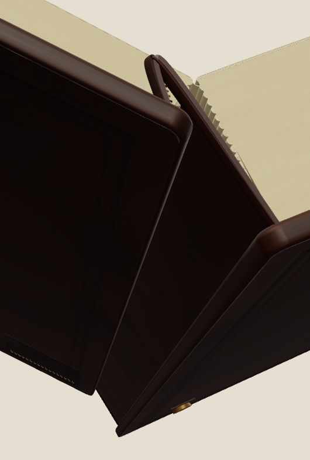
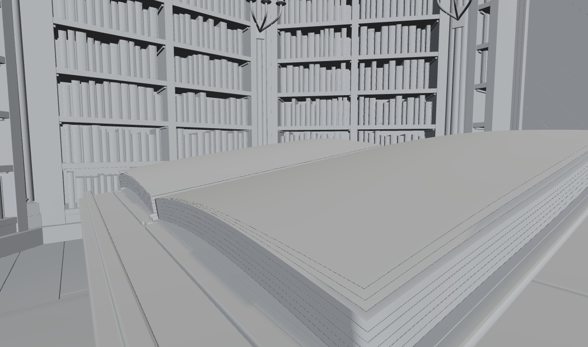

# Images and visual evidence

Source media, authored artwork, and software captures retain separate roles. Source stock marks remain visible. These files are not evidence of hidden construction or absolute source-image size.

## Ranked-cover originals

## Grimoire failure evidence

## Bound-open-book integration captures

## Authored artwork and current captures

See [archived V1 grimoire artwork](../history/snapshots.json), [grimoire screenshots](../objects/books/wizard-grimoire/exports/screenshots), [ranked-cover screenshots](../objects/books/default-book-design-types/exports/screenshots), and [ranked-cover editable SVG collection](../objects/books/default-book-design-types/exports/svg). The [attachment map](../history/conversations/attachments.json) records provenance and hashes.
