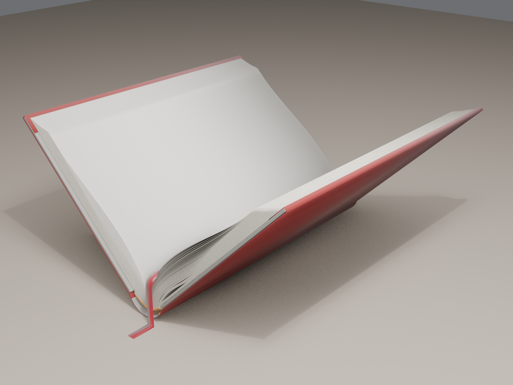

# Blender physics hardcover

A rounded-and-backed, hollow-back case binding modelled in Blender 5 with its opening driven by solved physics rather than posed by hand. A pure-Python cross-section solver finds the book's shape at 31 opening angles (0° to 90°). A Blender script turns those cross-sections into shape-keyed meshes, giving a 120-frame opening animation that plays with no simulation or handlers.

Companion document: [The Anatomy & Physics of the Book](references/document/anatomy-and-physics-of-the-book.md) ([PDF with diagrams](references/document/anatomy-and-physics-of-the-book.pdf); live copy at https://claude.ai/artifact/28AFYaKzzP7PZHzk95yL3c). Its "Before you build" table and the "What not to forget, or else…" notes at the end of each section apply to this model. Model-specific notes are in [knowledge.md](knowledge.md).

## Files

| Part | File | Role |
|---|---|---|
| Construction / state | [solvers.py](Part_1-Engine-Root/solvers.py) | 2D geometry, heavy-elastica leaf solver (energy minimisation), clamped-elastica spine strip (Newton–Lagrange), graph contact, graded resampling |
| Construction / state | [mechanism.py](Part_1-Engine-Root/mechanism.py) | `PARAMS` (all dimensions in metres), derived quantities, `pose(alpha)` = the whole cross-section at one opening angle |
| Construction / state | [bake.py](Part_1-Engine-Root/bake.py) | Solves the 31 samples and writes `bake.json` |
| Construction / state | [bake.json](Part_1-Engine-Root/bake.json) | The verified bake (6.8 MB, 31 samples + meta) |
| Construction / state | [test_poses.py](Part_1-Engine-Root/test_poses.py), [plot.py](Part_1-Engine-Root/plot.py) | Checks (crossings, separation, length, gap) and PNG cross-section plots |
| Attachments / integration | [build_book.py](Part_2-Connectors/build_book.py) | Blender orchestrator: builds the "Book" collection, materials, shape keys, cameras |
| Appearance | [physics_hardcover_book.blend](Part_3-Outer-Look-Shell/blender/physics_hardcover_book.blend) | The saved scene; the five scripts and the bake are stored inside it as Text blocks |
| Appearance | [renders/](Part_3-Outer-Look-Shell/renders/hero_frame120.png) | Hero and head-gutter renders at frame 120 (90° open) |
| Evidence | [references/cross-sections/](references/cross-sections/plot_90_gutter.png) | Gutter cross-sections at 0°, 30°, 60° and 90° |

## Construction

| Component | Value |
|---|---|
| Text block | 150 × 230 mm, 320 pages in 20 signatures of 16 pages (162 leaves including flyleaves) |
| Paper | 80 g/m², caliper 0.127 mm (400 PPI), E ≈ 2.5 GPa cross-direction (approximate), D ≈ 4.3 × 10⁻⁴ N·m |
| Boards | 2.5 mm, 3 mm squares, 0.4 mm cloth, 15 mm turn-ins |
| Spine | Rounded to a 120° arc, backed with a 1.5 mm set radius; hollow tube, linings, stiffener, mull flanges 30 mm |
| Board-to-block allowance | 0.66 mm each side (turn-in + pastedown + flyleaf) |
| Opening | At page 168, to 90° total, over frames 1–120; sampled every 4 frames |

## Mechanism

- **Boards** pivot in the joint grooves at the ends of the case spine arc, not at the shoulders. Opening swings the shoulders about 2 mm apart at 90°.
- **Spine strip** (the lined text-block spine) is an inextensible clamped elastica between the two shoulders. The hollow between it and the case spine grows from 0.96 mm closed to 2.69 mm at 90°.
- **Leaves** are heavy elastic plates. Each starts from its fold with the backing set arc, stays lifted for its detachment length ℓ, where p·ℓ⁴/(24D) − θ·ℓ − 3h₀ = 0, then rests on the leaf below at exactly one caliper's separation.
- **Contact** is a height graph: each leaf lies at or above the one below plus t, and never past the opened fold. Leaves cannot cross.

## Run

1. Open `physics_hardcover_book.blend` in Blender 5. Press play to see the animation.
2. To change the book, edit `PARAMS` in the `mechanism.py` Text block, set `REBAKE = True` in `build_book.py`, and run it (Text Editor › Run Script). The rebake takes about 4 minutes.
3. Outside Blender, `python3 bake.py` and `python3 test_poses.py` in `Part_1-Engine-Root` run the solver and its checks with no dependencies.

## Verification (this bake)

All 31 samples: minimum leaf separation 0.127 mm (exactly one caliper), every leaf 150.00 mm long, no crossings, hollow gap monotone 0.96 → 2.69 mm, spine strip solved, case resting at z = 0, shape-key weights summing to 1.0 on every frame. These are geometric checks of the model, not a certification of material behaviour.
